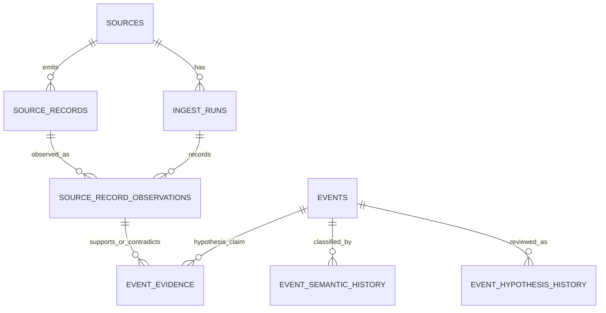

# ADR draft: Source records and evidence model v1

**Status: PROPOSED — not accepted, implemented, or authorized for migration**  
**Scope:** design for GDELT Events and GOV.UK Atom provenance; no code or schema changes.  
**Decision owner:** project owner after independent Vexi review.

## Context and current state

SQLite schema v2 has `sources`, `ingest_runs`, `events`, `event_sources`, and
`schema_migrations`. `events.dedup_key` is globally unique. The
`event_sources` primary key `(event_id, source_id)` stores one current
provenance summary per event/source pair: URL, language, optional observed
country, current ingest run, and min/max collection times. It is not an article
catalogue or a history of source records and revisions. Keep these meanings and
existing read paths intact.
Importantly, v2 `events` already contains rows with potentially different
meanings, including GOV.UK publication records as well as candidate incident
records. Neither the table name nor `validation_status` reliably identifies
the semantic kind; the current schema has no audited classification field.
Treat every pre-existing row as **unclassified** until an explicit
classification is recorded. Do not infer that a legacy row is an incident
hypothesis or a confirmed incident.

The private data-model draft previously proposed `articles` and
`event_evidence`. The merged adapters now provide two different record types:

- GDELT Events supplies a provider observation, its `GLOBALEVENTID`,
  day-precision `SQLDATE`, UTC `DATEADDED`, CAMEO fields, source URL and
  unverified action-geography candidates.
- GOV.UK Atom supplies an official publication with an `atom_id`, optional
  `published` and `updated` values, canonical article URL and collection time.

Both adapters leave occurrence time and unverified geography unknown. The
adapter records do not themselves establish a real-world incident.

## Alternatives

| Option | Advantages | Gaps / compatibility cost |
| --- | --- | --- |
| **A. `articles` + `event_evidence`** (earlier conceptual draft) | Clear publisher-facing article identity; natural place for canonical URL, title, language and publication date. | A GDELT row is an aggregator observation, not an article. It needs another observation entity and a relationship to the article, creating parallel provenance paths and adapter-specific joins. Does not by itself preserve revisions or re-import history. |
| **B. `source_records` + evidence** | One provider-neutral identity can represent a GOV.UK publication or a GDELT provider observation. Provider IDs and source-specific record types remain explicit. | A simple mutable row loses changed snapshots and replay history. Evidence links also need a versioned observation target and an audit trail. |
| **C. Minimal additive v3 extension of v2** (**recommended**) | Adopt the generic source-record concept from B; retain v2 tables and add immutable record observations, evidence assertions, semantic-classification history and hypothesis history. Existing `events` and `event_sources` remain compatible projections. | Adds migration and indexes; read models must deliberately join the new tables. Backfill of existing v2 provenance needs a conservative, explicitly tested rule. |

Recommend **C**. Do not add a separate `articles` table in v1: a publisher
article/announcement is a `source_records.record_kind='publication'`; a GDELT
row is `record_kind='provider_observation'`. The source record identity is
provider-scoped, while its observation snapshots source-native metadata. This
reuses the intent of both earlier proposals without treating an article, a
provider row and a HORIZONT event hypothesis as the same entity.

## Conceptual boundaries and cardinality



- **Source:** the configured provider/feed already represented by `sources`;
  it is not a publisher article or evidence item.
- **Publication:** one publisher-side announcement or article. It is a
  `source_records` identity of kind `publication` and can support a claim about
  the fact or wording of that publication. GOV.UK is primary evidence that it
  issued an announcement, not automatic evidence that an unrelated physical
  event happened.
- **Provider observation:** a provider-native item such as a GDELT Events row.
  It records what that provider emitted, not the truth of the row's claims.
- **Event row:** a v2 `events` row whose semantic kind is not encoded by the
  current schema. It may represent a publication, an incident candidate, or
  another legacy meaning. For newly modeled data, publications belong in
  `source_records`; do not create a new `events` row merely to store an article.
- **Event hypothesis:** a proposed real-world incident represented by an
  `events` row only when an explicit classification-history entry says
  `incident_hypothesis`. Only the latest accepted, audited classification is
  effective; proposed or rejected classifications remain history. Until a
  separately authorized, audited decision changes its review state, the
  hypothesis remains pending; classification does not confirm occurrence.
- **Evidence assertion:** a versioned relation from one source-record
  observation to one hypothesis and one named claim (for example, occurrence
  date or location). Relation values are `supports`, `contradicts`, or
  `unverified`. One observation may link to zero, one, or several hypotheses;
  one hypothesis may have any number of evidence assertions. Contradictory
  assertions are retained together.
- **Independent corroboration:** an assessment about evidence lineage, not a
  count of rows, providers, or URLs. A GDELT row and the publisher URL it cites
  share one lineage and cannot count as two independent confirmations. Exact
  canonical URL reuse can be grouped deterministically; syndication, common
  ownership, and copied releases need reviewed lineage. If independence is
  unknown, it is not counted as independent. A claim is never auto-confirmed
  by item count or a score.

The history tables record explicit review decisions, including who/what made
the decision, when, rationale, the resulting state, and the previous history
entry. `events.validation_status` remains a current compatibility projection
for existing consumers; it is not a semantic classifier or independent
verification. Its `valid` value must not be interpreted as “confirmed real
incident.” Automated ingestion can add observations and pending evidence; it
cannot classify a legacy event as an incident or confirm an incident.

## Proposed schema-v3 dictionary (conceptual only)

No SQL from this section is migration-ready. Exact names, constraints, and
storage encodings require review in the implementation issue. The DDL snippets
below make required SQLite key/index syntax explicit for review; they do not
authorize a migration.

| Entity / field | Meaning and proposed constraint |
| --- | --- |
| `source_records.id` | Internal stable key. |
| `source_id` | FK to v2 `sources`; source that emitted the record, not necessarily the publisher named by its URL. |
| `record_kind` | `publication`, `provider_observation`, or `legacy_provenance`. |
| `provider_namespace`, `external_record_id` | Store together, scoped by `source_id`; unique when present. GDELT Events uses `source_id='gdelt-raw-events-v2'` and a GDELT Events namespace + `GLOBALEVENTID`; GOV.UK uses `source_id='govuk-news-atom-v1'` and an Atom namespace + `<id>`. GDELT DOC has its own source identity. None of these values is a HORIZONT event ID. A legacy v2 row has no invented external ID. |
| `source_record_observations` | Append-only normalized snapshot for one observed record/revision and ingest run. Composite FK must ensure the run and record belong to the same source. Uniqueness on source-record + run + metadata revision hash makes replay idempotent within a run while preserving later sightings. |
| `revision_hash` | SHA-256 of deterministic, allowlisted normalized metadata (not article body/raw XML or unrestricted provider payload). Changed metadata creates a new observation snapshot; older snapshots are never overwritten. |
| `canonical_url`, `title`, `source_language` | Nullable source-provided metadata, canonical URL validated at adapter boundary; language is not inferred. A URL is provenance, not proof of a distinct source. |
| `source_published_at`, `source_updated_at`, `collected_at` | Distinct nullable source times and required collection time, stored UTC only after strict offset validation. Unknown values stay `NULL`. |
| `gdelt_sqldate` | Nullable calendar `DATE` at day precision. Never convert to midnight or `occurred_at`. |
| `gdelt_dateadded_at` | Nullable GDELT detection/export timestamp normalized as UTC; separate from publisher time and local `collected_at`. The 15-minute boundary rule remains a pre-live question to verify against provider documentation/export behavior. |
| `cameo_code` | Preserve original GDELT CAMEO code as source-native text; do not infer severity or verification. |
| `geo_source_fields` | Preserve allowlisted GDELT type, full name, FIPS country, ADM1/ADM2, coordinates and feature ID as source-native pending candidates. Keep FIPS distinct from ISO event country. Do not copy candidates to event location or convert them automatically. GOV.UK location remains absent unless its record explicitly supplies one. |
| `rights_snapshot` | Per-observation license identifier/URI, provider/publisher attribution, canonical source link and rights note. Do not assume all linked media or third-party works share the publisher's licence. |
| `first_seen_at`, `last_seen_at` | Derived as `MIN`/`MAX` of immutable observation `collected_at` values for a record. They are not event or publication times and must be correct under out-of-order imports. |
| `event_evidence` | Append-only link to an observation and `events.id`, plus `claim_key`, `supports`/`contradicts`/`unverified`, evidence kind, review state, independence group/state, reviewer, decision time/rationale and optional superseded evidence ID. Reassessment appends a row; it does not rewrite the old assertion. |
| `event_semantic_history` | Append-only classification decisions for an `events.id`: `publication_record`, `incident_hypothesis`, or `other_or_unknown`, with actor, timestamp, rationale, review state, and superseded history ID. No history row means `unclassified`; legacy rows are never defaulted to `incident_hypothesis`. A semantic decision cannot by itself confirm occurrence. |
| `event_hypothesis_history` | Append-only snapshots only for rows whose latest accepted semantic classification is `incident_hypothesis`; include explicit human decision metadata. Current `events` fields remain the read projection; every confirmed/rejected transition needs a history entry. |

`event_sources` remains the v2 current summary for backwards compatibility. New
source-record history does not replace or reinterpret its `(event_id,
source_id)` semantics. Existing `events` are treated as unclassified until
audited classification history says otherwise. Migration must not auto-label
them as incident hypotheses or confirmed incidents. A migration may not
invent Atom IDs, GDELT IDs, publication times, coordinates, ISO countries, or
exact sighting times.

### Constraint and index sketch

```text
source_records:
  CHECK ((provider_namespace IS NULL) = (external_record_id IS NULL))
  -- NULL IDs are for explicitly labelled legacy provenance only.

-- Partial uniqueness is expressed as an index, not a table UNIQUE clause:
CREATE UNIQUE INDEX uq_source_records_provider_identity
  ON source_records(source_id, provider_namespace, external_record_id)
  WHERE external_record_id IS NOT NULL;

source_record_observations:
  -- Each composite parent key must be PRIMARY KEY or covered by a matching
  -- full UNIQUE constraint/index, even though id alone is already a primary key.
  source_records: UNIQUE(id, source_id)
  ingest_runs: UNIQUE(id, source_id)
  FOREIGN KEY(source_record_id, source_id)
    REFERENCES source_records(id, source_id)
  FOREIGN KEY(ingest_run_id, source_id)
    REFERENCES ingest_runs(id, source_id)
  UNIQUE(source_record_id, ingest_run_id, revision_hash)
  CHECK(collected_at is valid normalized UTC)

event_evidence:
  FK(observation_id) -> source_record_observations(id)
  FK(event_id) -> events(id)
  -- Writer transaction (or reviewed trigger) must reject evidence links unless
  -- the event's latest accepted semantic classification is incident_hypothesis.
  CHECK(relation IN ('supports', 'contradicts', 'unverified'))
  CHECK(independence_state IN ('independent', 'dependent', 'unknown'))
  -- A correction inserts a superseding row; the prior assertion is retained.

event_semantic_history:
  FK(event_id) -> events(id)
  CHECK(semantic_kind IN ('publication_record', 'incident_hypothesis',
                          'other_or_unknown'))
  -- No accepted decision means unclassified; decisions require actor, time,
  -- rationale, decision status, and optional supersedes link.
```

SQLite does not permit a partial index to serve as the parent key of a foreign
key. Composite references above therefore require matching full unique parent
keys such as `UNIQUE(id, source_id)` on **both** parent tables, even if `id`
alone is already a primary key. A partial unique index is not a substitute.
SQLite partial uniqueness uses `CREATE UNIQUE INDEX name ON table(columns...)
WHERE predicate;`; the predicate belongs to the index statement, not a
table-level `UNIQUE(...) WHERE ...` clause. The exact DDL must be validated on
the supported SQLite version with synthetic databases before migration.
Because SQLite cannot express the cross-table “latest accepted classification”
rule with a `CHECK`, evidence insertion must enforce that precondition in one
transaction or with a carefully tested trigger; it must fail closed for
unclassified, publication, and other/unknown rows. The chosen enforcement is
an implementation decision, not part of this proposal's authorization.

Candidate indexes: unique provider identity above; observation history on
`(source_record_id, collected_at, id)` and `(source_id, ingest_run_id)`;
evidence lookup on `(event_id, claim_key, created_at)` and
`(observation_id, event_id)`; hypothesis history on `(event_id, recorded_at,
id)`. Use only after confirming actual query plans with synthetic fixtures.

## Identity, replay and conflicting data

1. Identity is stable and provider-scoped: `(source_id, provider_namespace,
   external_record_id)`. If a future provider has no stable ID, a separately
   versioned deterministic URL/hash identity rule must be approved first; a
   title or fuzzy similarity is not an identity key.
2. An unchanged revision replay in the same run is idempotent. A later run
   appends an observation even when the content hash matches, so `first_seen`
   and `last_seen` can be derived and audited. A changed revision appends a
   different snapshot. An older backfill remains historical; insertion order
   never chooses “latest”. Current projections order by normalized source
   collection/observation time with a deterministic run/row tie-breaker.
3. The v2 `event_sources` min/max and newest-metadata update rules stay as-is.
   New record history is append-only and must not use an old backfill to
   overwrite a newer source state.
4. Evidence assertions name the claim they address. Opposing claims coexist;
   they set/keep the hypothesis unresolved pending review. Re-linking a record,
   merging/splitting a hypothesis, or correcting an evidence assessment is
   represented by new history/decision rows with a supersedes link, not by
   deleting the old relation.
5. A distinct independence group must be reviewed as independent before it can
   support a corroboration decision. GDELT plus its cited publisher item belong
   to the same lineage. One official announcement can establish the existence
   of that announcement without establishing the physical occurrence it
   describes. No minimum numerical threshold is accepted in this ADR; a
   later validation policy must define the claim-specific human review rule.

## Retention, licensing, capacity and access boundaries

- Persist metadata needed to identify and assess a record; do not persist full
  article bodies, raw feeds, unrestricted raw GDELT TSV rows, secrets, or
  unnecessary personal data. Keep only source fields needed for provenance,
  claim evaluation and reproducible interpretation.
- Store attribution and item-level rights/licence snapshots. GOV.UK OGL v3
  does not grant blanket rights to third-party works, personal data, logos or
  excluded material. GDELT provider terms and the underlying publisher's
  terms remain separate. Link to canonical sources; do not imply that public
  accessibility permits copying or long-term retention.
- A retention/expiry/deletion policy is required before live data. Deletion
  must account for dependent observations/evidence and leave an auditable
  tombstone or decision where legally allowed; exact time limits and legal
  basis remain owner/legal-review questions.
- Each future collector must enforce per-source byte and row limits before
  parsing/writing, plus field-length and URL limits. Existing GOV.UK parsing
  limits (128 KiB/10 entries) remain. For GDELT, the existing raw-feed reader
  uses bounded archives/rows, but the in-memory Events projection still needs
  an explicit batch cap before any staging/live use. The initial 5,000-row /
  8 MiB uncompressed limits are a candidate only, not verified throughput or
  authorization; confirm against the source gate before implementation.
- One authorized local writer, one atomic bounded batch transaction, foreign
  keys and schema checks. Failed batches roll back all record/evidence rows
  and retain only a failed run record. Keep SQLite WAL local; it is not a
  network/shared database. Read APIs remain fixed-query/read-only.
- Existing API/UI must not query or expose new records by default. Any future
  public or operator-facing read model requires separate access-control,
  authorization, pagination/output bounds and privacy review. A bearer must
  never enter browser code. Reader deployments continue to consume only an
  independently sealed read-only snapshot; do not mount an active writer WAL
  as a shared read view.
- A future verified encrypted backup/restore must use the approved SQLite
  online backup path and a fresh target, then check integrity, foreign keys,
  schema versions and checksums. A copied database on the same host is not
  independent disaster recovery.

## Migration, verification and rollback plan (future gated work)

This ADR does **not** execute a migration. If this proposal is accepted, a
separate implementation issue and PR must:

1. Inventory v2 schema and data using a read-only review on an isolated
   synthetic database; do not inspect or mutate a persistent LAB database as
   part of implementation.
2. Add migration 3 as additive DDL only. Preserve `events`, `event_sources`,
   existing IDs, indexes and query contracts. Apply the DDL and migration
   marker in one explicit transaction, with foreign keys/checks and indexes.
3. Preserve old `event_sources` and `events` exactly; do not automatically
   backfill them into source-record evidence or assign event semantics during
   schema migration. Existing v2 rows remain accessible through the current
   tables/read contract but are unclassified in new semantic-aware views. If
   a later approved report needs legacy rows in the new model, handle that in
   a separate deterministic conversion: label provenance `legacy_provenance`,
   leave external provider IDs null, preserve only known aggregate first/last
   bounds, and do not treat it as independent evidence. A row may be classified
   as a publication or incident hypothesis only through a separate explicit,
   auditable review decision; it must never be auto-promoted to confirmed
   incident. No guessed mapping is acceptable.
4. Test migration from a newly created synthetic v2 database and v2-shaped
   sample fixtures first, then v2→v3 integrity, foreign-key and index
   validation. Run interrupted-DDL rollback/retry, idempotency, replay and
   read-only v2 query regression tests. Validate new read models against a
   sealed synthetic snapshot before any separate operator approval.
5. Before any separately authorized non-synthetic migration, create and verify
   a SQLite online-backup snapshot. Use a single controlled writer and a
   stopped/maintenance window; never migrate on API or reader startup. No
   provider transport or live records are part of that gate.

If migration DDL fails, its transaction must leave the v2 database unchanged
and retryable. For a later approved deployment, rollback is not an in-place
down-migration: stop the writer, preserve the original database and WAL/SHM,
verify the pre-migration snapshot, and restore only to a fresh path. Switch back
only after integrity and data-delta review. If any post-migration writes exist,
do not restore an older snapshot over them; reconcile/export them or keep the
additive v3 database and fix forward. A fresh synthetic test database can be
discarded; no test procedure may target an existing persistent file.

## Synthetic acceptance-test contract

The future v3 implementation must use only generated fixtures and temporary
SQLite databases and cover:

| Area | Required synthetic case |
| --- | --- |
| Identity / dedup | Same provider namespace + external ID replay; same ID in another namespace; duplicate canonical URL across providers; missing external ID without a guessed collision. |
| Revisions / history | Unchanged replay across runs; changed metadata revision; out-of-order backfill after a newer observation; deterministic current projection and first/last seen; no lost earlier revision. |
| Evidence / conflict | One observation to zero/one/multiple hypotheses; multiple observations per hypothesis; `supports` and `contradicts` coexist for one claim; superseded assessment remains in history. |
| Legacy semantics | A synthetic v2 fixture contains a GOV.UK publication row and an incident candidate in `events`; after additive migration both rows remain unchanged and have no semantic-history row, both read as `unclassified`, and neither appears as a confirmed incident. Only an explicit reviewed history entry can classify either; classification alone still does not confirm occurrence. |
| Independence | GDELT record and its cited publisher URL share lineage; same syndicated article group does not double count; unknown lineage is excluded from independent count; genuinely independent synthetic source groups remain distinct. |
| Time / nulls | GDELT `SQLDATE` remains a date; `DATEADDED`, Atom published/updated and collected times remain separate UTC values; missing values stay `NULL`; invalid offsets rejected; no inferred `occurred_at`. |
| Geography | Type-zero/empty GDELT geo stays unknown; raw FIPS/ADM values remain candidates; FIPS is not ISO event country; no invented coordinates or GOV.UK jurisdiction-derived location. |
| Rights / minimization | Attribution/licence snapshot survives revisions; no article body, raw feed, secret or unnecessary personal data is persisted; source URL remains traceable. |
| Bounds / failures | Zero-byte, malformed and over-limit data fail closed; row/byte caps enforced before writes; a late insert/constraint failure rolls back the entire batch and marks the run failed. |
| Migration / compatibility | Fresh v2→v3 migration, interrupted DDL rollback/retry, idempotent migrate, FK/index checks, existing v2 query behavior and data unchanged, restore only to a new synthetic destination. |

Repository checks for this design PR remain the current hygiene check and
existing offline unittest/CI suite; there is no SQL migration test to run until
separately approved implementation exists.

## Decisions still required before implementation

1. Accept or revise the recommended generic source-record model and its
   append-only observation/evidence/history tables.
2. Approve the exact legacy v2 backfill behavior and whether legacy provenance
   appears in v3 read views.
3. Define who may assess lineage/independence and change a hypothesis state,
   and what auditable actor identity is available in the current single-user
   architecture.
4. Set a retention/deletion schedule and rights-review procedure for each
   provider and publisher.
5. Confirm GDELT `DATEADDED` boundary validation and per-source row/byte caps
   before any GDELT staging/live parser or writer.
6. Decide whether `event_sources` remains a permanent compatibility summary
   or is deprecated only after all consumers have an approved replacement.
7. Approve the semantic vocabulary and review workflow for classifying
   existing `events` rows, including who may record a classification and how
   semantic-aware read views handle unclassified records.

Until these questions are resolved, this is a design recommendation only: no
schema version change, code change, live feed, real data, database write,
service, host, or deployment is authorized.
